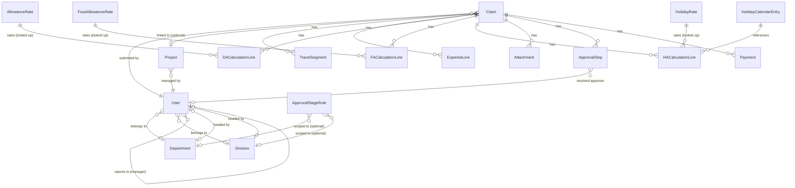

# Billgo — Technical Documentation

**Bill Management System** for ERA InfoTech Limited — a Travel (TA), Daily (DA), Food (FA) &
Holiday (HA) allowance claims platform. This document is the technical reference for
developers maintaining or extending the codebase. For a role-based usage guide, see
[USER_MANUAL.md](./USER_MANUAL.md).

## 1. Overview

Billgo digitizes the employee allowance claim lifecycle end to end: an employee creates a
claim, the system auto-calculates entitlements from admin-configured policy rates, the claim
routes through a configurable multi-stage approval chain, Finance verifies and adjusts, and a
Payment Processor records payout. Every stage is audited.

The system was built against a formal Business Requirements Document (BRD) for ERA InfoTech
Limited and implements it in phases:

- **Phase 1 (current)** — full core lifecycle: auth/RBAC, claim creation (TA/DA/FA/HA/Combined),
  policy-driven calculation, a dynamic multi-stage approval workflow, payment recording, audit
  log, in-app notifications, admin configuration, and 5 core reports.
- **Phase 2 (planned)** — remaining reports, delegation & bulk-approve, SLA escalation, PDF
  export, printable claim view.
- **Phase 3 (planned)** — HRMS/SSO/payroll integrations, email/SMS gateway, cloud document
  storage, a secured public API.
- **Phase 4 (planned)** — Postgres migration, backup/monitoring, load testing, security review.

## 2. Tech Stack

| Layer | Choice |
|---|---|
| Framework | Next.js 16 (App Router, Turbopack), React 19 |
| Language | TypeScript (strict mode) |
| Styling | Tailwind CSS 4 |
| Database | SQLite via `@prisma/adapter-libsql` (dev) — swappable for Postgres via `@prisma/adapter-pg` (already installed) for production |
| ORM | Prisma 7 |
| Auth | Custom session cookies signed with `jose` (JWT/JWS), passwords hashed with `bcryptjs` |
| Validation | `zod` |
| Mutations | Next.js Server Actions (no separate REST API in Phase 1) |

No authentication library (NextAuth/Auth.js) or state-management library is used — the app
leans on React Server Components + Server Actions and plain `useState` for client forms.

## 3. Architecture

```
Browser
  │
  ▼
proxy.ts (Next.js "middleware", runs on the Node.js runtime)
  │  — verifies the session JWT, redirects to /login if absent
  │  — coarse route gating: /admin/* → ADMIN_ROLES, /reports/* → REPORT_ROLES
  ▼
app/**/page.tsx (Server Components)
  │  — read data directly via Prisma (through lib/db.ts)
  │  — render Client Components for interactive forms
  │
app/**/actions.ts ("use server" Server Actions)
  │  — re-check auth/ownership/role for the specific mutation
  │  — parse input with zod (lib/validation.ts)
  │  — delegate to lib/ services
  ▼
lib/*.ts (business logic / service layer)
  │  — claims.ts, workflow.ts, calculations.ts, audit.ts, notifications.ts, storage.ts, reports.ts
  ▼
Prisma Client → SQLite (dev.db) / Postgres (production, via DATABASE_URL)
```

Key design decision: **all business logic lives in `lib/`, not inline in Server Actions or
page components.** Actions are thin wrappers that authenticate, validate, and call a `lib/`
function. This is what lets Phase 3's public API reuse the exact same logic without
rewriting anything.

### 3.1 Why `proxy.ts` and not `middleware.ts`

Next.js 16 renamed the middleware convention file from `middleware.ts` to `proxy.ts`. Unlike
the legacy convention (Edge runtime only), `proxy.ts` runs on the **Node.js runtime** by
default, which is required here because it queries Prisma/SQLite directly for the session
user's current role and status (rather than trusting a possibly-stale JWT claim).

The `experimental.nodeMiddleware: true` flag in `next.config.ts` is required at runtime in
this Next.js version even though it isn't yet reflected in the shipped `NextConfig` type
(hence the `@ts-expect-error` on that line).

### 3.2 Static asset gotcha

`proxy.ts`'s matcher excludes Next internals (`_next/static`, `_next/image`, `favicon.ico`,
`api/health`) **and any request path ending in a common image extension**
(`png|jpg|jpeg|gif|svg|ico|webp`). This is necessary because the login page itself needs to
serve the logo to an unauthenticated visitor — without this exclusion, static assets under
`public/` get redirected to `/login` just like any other protected route.

## 4. Data Model

All "enum-like" columns (`role`, `status`, `claimType`, etc.) are plain `String` columns, not
native database enums — **SQLite has no enum type**. Allowed values are documented inline in
`prisma/schema.prisma` and enforced at the application layer via `lib/constants.ts` (arrays +
TypeScript union types) and `lib/validation.ts` (zod schemas).

### 4.1 Entity-relationship overview



### 4.2 Core entities

| Model | Purpose |
|---|---|
| `User` | Employee record: role, department, division, manager (self-relation), grade/costCenter/location used by the calculation engine. |
| `Department` / `Division` | Two independent organizational axes, each with an optional head (a `User`). Both can scope an `ApprovalStageRule`. |
| `Project` | Has exactly one `projectManagerId`. A `Claim` can optionally link to one, enabling a `PROJECT_MANAGER` approval stage. |
| `HolidayCalendarEntry` | Configured holiday dates (NATIONAL/REGIONAL/SPECIAL) — HA claims must reference one. |
| `AllowanceRate` / `FoodAllowanceRate` | Effective-dated daily rate by grade + location category (DOMESTIC/INTERNATIONAL). Drive DA and FA respectively. |
| `HolidayRate` | Effective-dated rate + multiplier by grade (nullable = any grade). Drives HA. |
| `PolicyParameter` | Generic key/value config store, e.g. `DA_FULL_DAY_HOUR_THRESHOLD`, `FA_FULL_DAY_HOUR_THRESHOLD`. |
| `ApprovalStageRule` | One row = one stage in the approval matrix: `claimType` + `[minAmount, maxAmount]` + optional department/division scope + `stageOrder` + `requiredRole`. |
| `Claim` | The claim header: type, status, totals (claimed/eligible/approved/payable), advance, optional project link. |
| `TravelSegment`, `ExpenseLine`, `DACalculationLine`, `FACalculationLine`, `HACalculationLine` | Child line items, one table per claim component. |
| `Attachment` | Uploaded supporting documents (local disk in Phase 1 — see `lib/storage.ts`). |
| `ApprovalStep` | One materialized row per stage the claim actually routes through (built at submission time). Status: `PENDING`/`APPROVED`/`RETURNED`/`REJECTED`/`SKIPPED`. |
| `Payment` | Payment record, one-to-many per claim (Phase 1 records exactly one). |
| `AuditLog` | Append-only, written exclusively through `lib/audit.ts`. |
| `Notification` | In-app notification (Phase 1 has no email/SMS delivery). |

### 4.3 Claim statuses

`DRAFT → SUBMITTED → PENDING_MANAGER → [PENDING_DIVISION_HEAD] → [PENDING_DEPT_HEAD] →
[PENDING_PROJECT_MANAGER] → PENDING_FINANCE → [PENDING_FINAL_APPROVAL] → APPROVED → PAID →
CLOSED`, with `RETURNED`, `REJECTED`, `CANCELLED`, and `ON_HOLD` as side branches. Bracketed
stages are conditional on the approval matrix and the claim's/employee's context (see §5.2).

## 5. Business Logic

### 5.1 Calculation engine (`lib/calculations.ts`)

DA and FA share an identical mechanism (`calculateDurationDays` + a rate lookup):

1. Compute total hours between the line's `fromDate` and `toDate`.
2. Whole 24-hour blocks count as full days. A trailing partial day counts as a **full day** if
   it clears the configured hour threshold (`DA_FULL_DAY_HOUR_THRESHOLD` /
   `FA_FULL_DAY_HOUR_THRESHOLD` from `PolicyParameter`, default 12h), otherwise **half a day**.
3. Look up the effective-dated rate for the employee's grade + the line's location category
   (`AllowanceRate` / `FoodAllowanceRate`), picking the most recent `effectiveFrom ≤ date`.
4. `entitledAmount = max(durationDays × rateApplied − deduction, 0)`.

HA (`calculateHA`) looks up `HolidayRate` (preferring a grade-specific row over a
grade-`null`/"any" row) and computes `rateApplied × multiplier × (isFullDay ? 1 : 0.5)`.

> The BRD's Appendix C explicitly lists real rate tables and formulas as open items pending
> policy workshops — so this engine is entirely config-driven from admin-editable rate tables.
> Seed data ships illustrative example rates, clearly not assumed-correct policy.

### 5.2 Approval workflow engine (`lib/workflow.ts`)

The approval matrix (`ApprovalStageRule`) is a flat list of stage definitions. At submission
time, `buildApprovalSteps()`:

1. Selects rules matching the claim's `claimType` (or `ANY`) and whose `[minAmount, maxAmount]`
   range contains `totalClaimed`.
2. Keeps the most specific rule per `stageOrder` (a department/division-scoped rule beats an
   "applies to any" rule for the same order).
3. For each remaining stage, resolves an approver via `resolveApprover()`:

   | `requiredRole` | Resolution | If unresolvable |
   |---|---|---|
   | `MANAGER` | `employee.managerId` | **Hard error** — blocks submission |
   | `DEPT_HEAD` | `employee.department.headUserId` | **Hard error** |
   | `DIVISION_HEAD` | `employee.division.headUserId` | **Skipped** if employee has no division; **hard error** if they do but it has no head |
   | `PROJECT_MANAGER` | `claim.project.projectManagerId` | **Skipped** if claim has no project; **hard error** if it does but has no manager |
   | `FINANCE` / `FINAL_APPROVER` | First `ACTIVE` user holding that `Role` | **Hard error** |

   This "skip vs. error" split (`OPTIONAL_STAGE_ROLES` in `lib/constants.ts`) is what lets
   Division Head and Project Manager stages apply broadly in the matrix without blocking every
   claim from an employee with no division or a claim with no project.

4. Creates one `ApprovalStep` row per stage (status `PENDING` or `SKIPPED`), sets
   `Claim.currentStageOrder`/`status` to the first `PENDING` step, and notifies that approver.
   If every stage was skipped, the claim auto-approves.

`actOnApprovalStep()` handles Approve/Return/Reject: it verifies the acting user is the
assigned approver at the currently-active stage, requires comments on Return/Reject, lets
Finance override `totalApproved` on approval, and — on approve — advances to the next
`PENDING` step (explicitly skipping over `SKIPPED` ones) or finalizes the claim as `APPROVED`
if none remain.

Returning a claim does **not** overwrite the `ApprovalStep` row — `reopenCurrentStage()`
creates a **new** step for the same stage on resubmission, so the original `RETURNED` row
stays in history (this is also what "Approve a resubmitted claim" and "Copy a rejected claim
as a new draft" build on).

### 5.3 Claim service (`lib/claims.ts`)

Owns the full lifecycle: `createDraftClaim` / `updateDraftClaim` (recompute lines + totals via
the calculation engine on every save), `submitClaim` (validates ≥1 attachment, checks travel
date overlap against the employee's other active claims, assigns the claim number
`CLM-YYYYMM-####`, calls `buildApprovalSteps`), `withdrawClaim` (only before the first
approval), `cancelClaim` (admin/finance, any pre-payment stage, reason required),
`resubmitClaim`, `copyClaimAsDraft`, `addAttachment`, `recordPayment`.

## 6. Authentication & Authorization

- **Session**: a signed JWT (HS256 via `jose`) in an `httpOnly` cookie, containing the user id.
  `getCurrentUser()` re-fetches the user from the DB on every call (not just decoding the JWT)
  so a deactivated/role-changed user is reflected immediately, not after their session expires.
- **Passwords**: hashed with `bcryptjs` (`lib/password.ts`), never stored or logged in plaintext.
- **RBAC**: `lib/constants.ts` defines `Role` and role-group arrays (`ADMIN_ROLES`,
  `REPORT_ROLES`, `ORG_WIDE_CLAIM_VIEW_ROLES`, …). Enforcement happens at **two** layers:
  1. `proxy.ts` — coarse route gating (redirect before the page even renders).
  2. Every page/Server Action re-checks ownership/role itself — e.g. the claim detail page
     grants access only to the claim's owner, an approver ever assigned a step on it, or an
     org-wide viewer role; `requireAdmin()` is called at the top of every admin Server Action.
- **`SESSION_SECRET`**: required in production (`NODE_ENV=production`); falls back to an
  insecure dev-only string otherwise, and `lib/auth.ts` throws rather than silently sign with
  the default in production.

> **Known gap to watch**: approver identity is resolved by *relationship* (manager/dept/division
> head, project manager), not by the viewer's own `User.role`. Don't gate a feature on
> `user.role` membership when the real question is "does this user have a pending
> `ApprovalStep`?" — an earlier version of the Approvals inbox had exactly this bug.

## 7. Repository Structure

```
app/
  layout.tsx, page.tsx, globals.css, icon.png     — root layout, favicon, redirect to /dashboard
  login/                                          — login page + form + action
  dashboard/                                      — employee stat cards + recent claims
  claims/
    page.tsx                                      — list/search (own claims, or org-wide for finance/payment/auditor/admin roles)
    new/                                          — new claim page + shared ClaimForm client component
    [id]/                                         — claim detail (approve/return/reject, payment, attachments)
    [id]/edit/                                    — edit draft / resubmit returned claim
    actions.ts                                     — all claim-related Server Actions
  approvals/                                      — pending-approval inbox (query by ApprovalStep, not by role)
  admin/
    layout.tsx                                    — admin tab nav, gates on ADMIN_ROLES
    users/ departments/ divisions/ projects/
    holidays/ rates/ approval-matrix/ audit-log/   — one page.tsx + actions.ts pair each
  reports/                                         — report picker + 5 report pages, CSV export via api/reports/[report]
  api/
    attachments/[id]/                              — authenticated file download route handler
    reports/[report]/                              — CSV export route handler
  notifications/                                   — in-app notification list

components/
  app-shell.tsx        — top nav (logo/wordmark, role-aware links, notification/approval badges)
  action-form.tsx       — generic client wrapper: calls a Server Action, shows inline errors instead of throwing to an error boundary
  report-table.tsx      — shared report rendering + CSV download button

lib/
  db.ts                 — Prisma client singleton (null when unconfigured, so pages degrade gracefully)
  auth.ts, password.ts   — session + password hashing
  constants.ts           — Role/ClaimType/ClaimStatus/StageRole enums and derived groupings
  validation.ts          — all zod schemas
  action-result.ts        — shared { ok, error } / { ok, ...data } Server Action return type
  claims.ts               — claim lifecycle service
  workflow.ts              — approval routing engine
  calculations.ts          — DA/FA/HA calculation engine
  audit.ts, notifications.ts, storage.ts, reports.ts, queries.ts

prisma/
  schema.prisma          — data model (see §4)
  seed.ts                 — wipes and reseeds demo org/policy/claims data

proxy.ts                  — Next.js middleware (Node runtime) — see §3.1
next.config.ts, prisma.config.ts, middleware config, etc.
```

## 8. Environment & Configuration

| Variable | Required? | Purpose |
|---|---|---|
| `DATABASE_URL` | No (dev) | Defaults to local `file:./dev.db` (SQLite via libSQL) when unset and `NODE_ENV !== "production"`. Point at Postgres for Phase 4. |
| `SESSION_SECRET` | Yes in production | Signs session JWTs. Generate with `node -e "console.log(require('crypto').randomBytes(32).toString('hex'))"`. |

See `.env.example`. Copy it to `.env` to override defaults locally.

## 9. Local Development

```bash
npm install                 # also runs `prisma generate` via postinstall
npm run db:push             # sync prisma/schema.prisma to the local SQLite file
npm run db:seed             # wipe + seed demo org, rates, approval matrix, sample claims
npm run dev                 # start the dev server at http://localhost:3000
```

Seeded accounts all share the password `Passw0rd!` — see `prisma/seed.ts` for the full list
(covers every role, plus a Division Head and Project Manager who deliberately do **not** hold
a special `Role`, to prove those stages resolve by relationship).

**After any `prisma/schema.prisma` change**: run `npm run db:push` then restart the dev
server. A running `next dev` process caches the previously-generated Prisma Client in Node's
module cache — regenerating the client on disk does not update an already-running process.

```bash
npm run lint                # eslint
npx tsc --noEmit             # type-check
npm run build                # production build (also type-checks)
```

## 10. Deployment Notes (Phase 4, not yet done)

1. Provision Postgres, set `DATABASE_URL`, switch `lib/db.ts` to `@prisma/adapter-pg` (already
   an installed dependency) and `prisma/schema.prisma`'s `datasource.provider` to `"postgresql"`.
2. Set a strong `SESSION_SECRET` and `NODE_ENV=production`.
3. Replace `lib/storage.ts`'s local-disk implementation with cloud object storage — it's
   already behind a narrow `saveAttachment`/`readAttachment` interface for exactly this swap.
4. Add backup/monitoring, and re-run the verification steps in §11 against the new datastore.

## 11. Testing / Verification Approach

There is no automated test suite yet (Phase 1 scope). Verification during development relied
on:

- `tsc --noEmit`, `eslint`, `next build` — must all pass clean.
- `prisma/seed.ts` exercising the real service layer (`createDraftClaim` → `submitClaim` →
  `actOnApprovalStep` → `recordPayment`) rather than raw SQL, so seeding itself is a smoke test
  of the business logic.
- Playwright-driven click-throughs (ad hoc scripts, not committed) covering login → create →
  attach → submit → approve at each stage type → payment, across every role, checking both
  screen content and HTTP status codes.

`playwright` is a `devDependency` for this purpose; there's no CI wiring for it yet.

## 12. Known Limitations (Phase 1)

- Single Payment Processor queue (no per-department routing), no delegation/bulk-approve, no
  email/SMS delivery, no PDF export, only 5 of the BRD's 15 reports, no historical rate
  versioning UI beyond effective dates, local-disk attachment storage only, no automated tests.
