# Billgo — User Manual

**Bill Management System** for ERA InfoTech Limited. This guide walks through every screen by
role. For architecture/developer details, see [TECHNICAL_DOCUMENTATION.md](./TECHNICAL_DOCUMENTATION.md).

## Contents

1. [Signing in](#1-signing-in)
2. [Everyone: Dashboard, claims & notifications](#2-everyone-dashboard-claims--notifications)
3. [Approvers: reviewing claims](#3-approvers-reviewing-claims)
4. [Payment Processor: recording payment](#4-payment-processor-recording-payment)
5. [Administrators: system configuration](#5-administrators-system-configuration)
6. [Reports](#6-reports)
7. [Roles at a glance](#7-roles-at-a-glance)
8. [Frequently asked questions](#8-frequently-asked-questions)

---

## 1. Signing in

Go to the application URL — you'll land on the sign-in page. Enter your work email and
password.

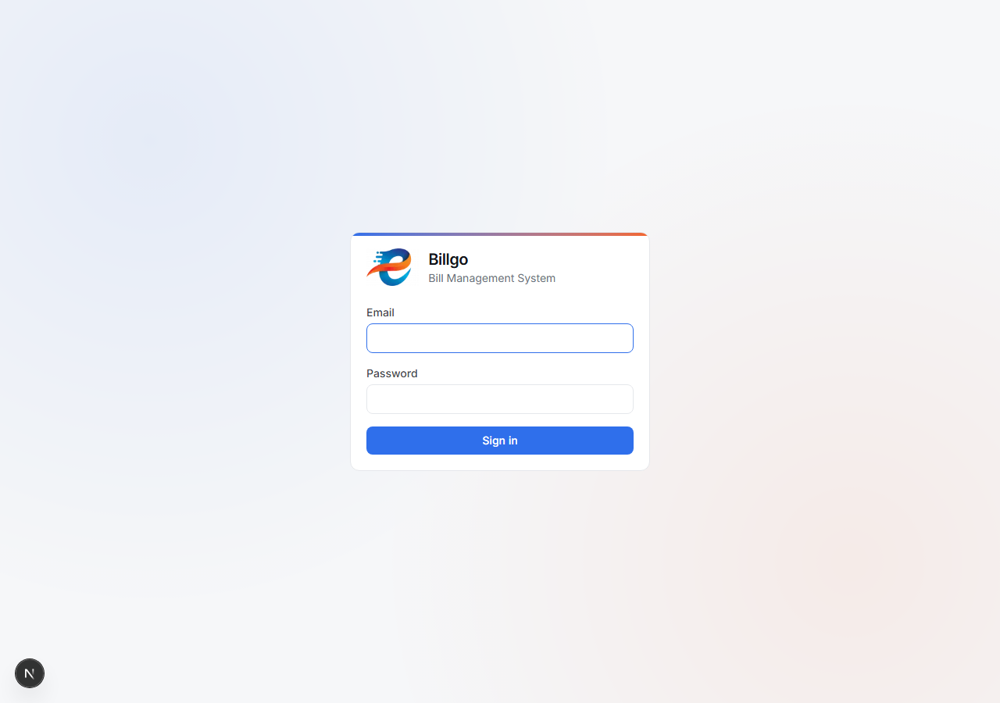

If you don't have credentials, ask your System Administrator to create your account (see
[§5.1](#51-users)).

---

## 2. Everyone: Dashboard, claims & notifications

Every user — regardless of role — can create and submit their own claims. Approvers, Finance,
and Admins are also employees who may need to claim their own travel or allowances.

### 2.1 Dashboard

After signing in you land on your dashboard: draft/pending/returned/approved/paid counts and
amounts, plus your most recent claims.

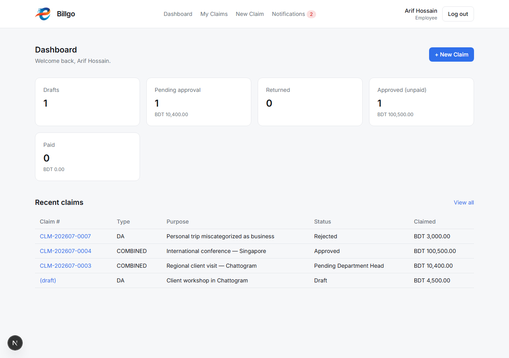

### 2.2 Viewing your claims

**My Claims** in the top nav lists every claim you've created, newest first, with filters for
status, claim type, and a text search on claim number/purpose.

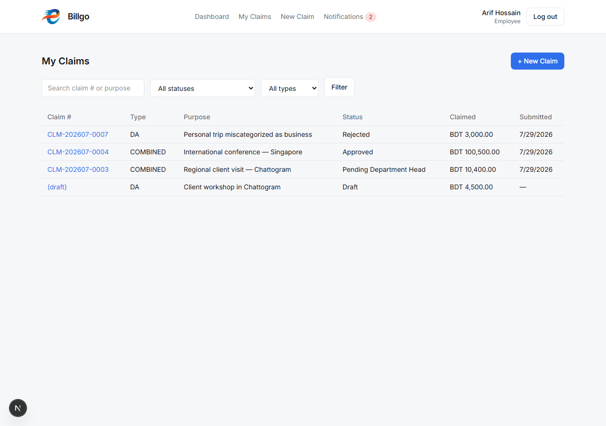

> Finance, Payment Processor, Auditor, and Admin roles get an extra **My claims / All claims**
> toggle here, so they can search claims org-wide (e.g. Payment Processor finding every
> `APPROVED` claim ready to pay).

### 2.3 Creating a new claim

Click **New Claim**. Pick a claim type:

- **TA** (Travel Allowance) — one or more travel segments (origin, destination, dates, mode, fare)
- **DA** (Daily Allowance) — auto-calculated per-day rate over a date range
- **FA** (Food Allowance) — same mechanism as DA, its own rate table
- **HA** (Holiday Allowance) — tied to a configured holiday calendar date
- **COMBINED** — any mix of the above, plus free-form expense lines (lodging, meals, conveyance, etc.)

You can also optionally link the claim to a **Project** — do this if the travel/work relates
to a specific project with its own Project Manager, since it may add a Project Manager
approval stage.

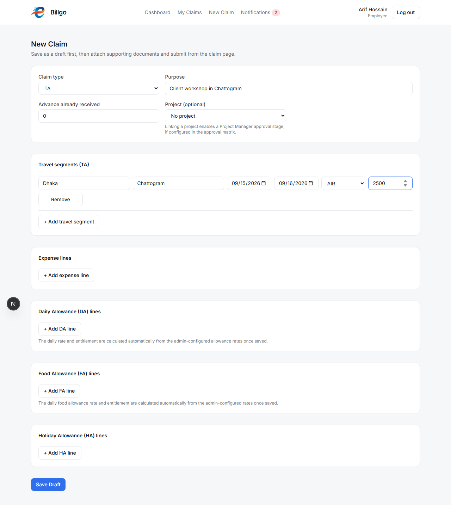

For DA/FA lines, pick Domestic or International and a date/time range — the system computes
the number of days (a trailing partial day counts as a full day past a configured hour
threshold, otherwise half a day) and the entitled amount from the admin-configured rate for
your grade. You don't enter an amount yourself for DA/FA/HA lines — it's calculated for you
once saved.

Click **Save Draft**. This does *not* submit the claim yet — you land on the claim's detail
page as a **Draft**, which you can keep editing.

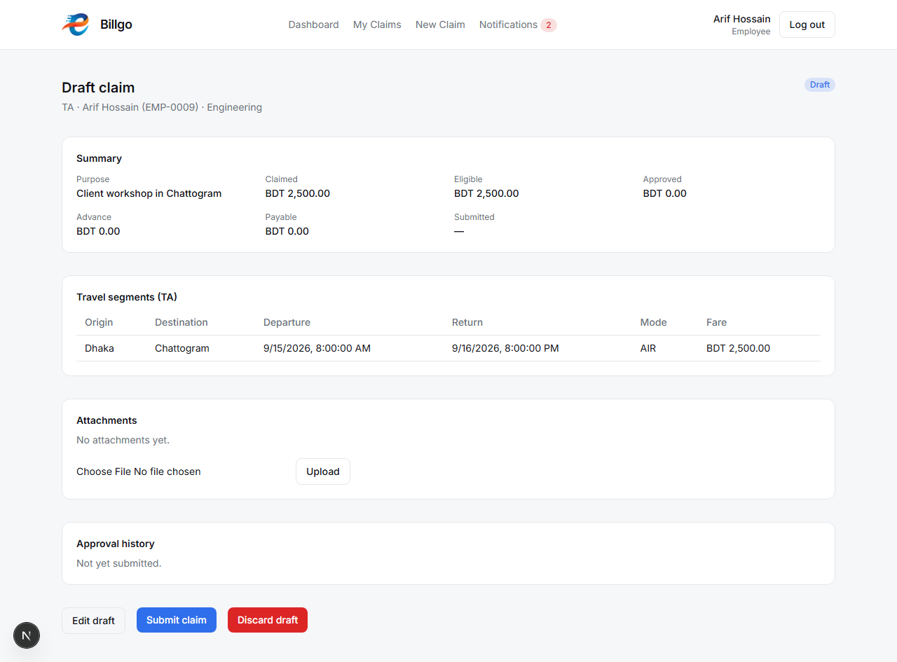

### 2.4 Attaching supporting documents

A claim needs **at least one attachment** (ticket, invoice, attendance evidence, etc.) before
it can be submitted. On the draft's detail page, choose a file and click **Upload**.

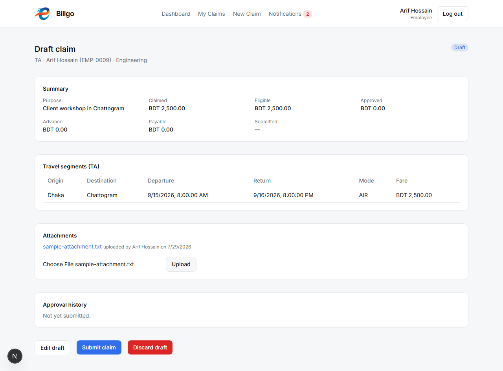

### 2.5 Submitting

Once you have at least one attachment, click **Submit claim**. The system:

- Assigns a claim number (`CLM-YYYYMM-####`)
- Checks your travel dates don't overlap an existing active claim
- Routes it to the first approval stage (usually your Reporting Manager) and notifies them

The claim detail page now shows its status and full **Approval history** — every stage it
will pass through, including ones automatically marked **SKIPPED** if they don't apply (e.g.
Division Head, if you're not in a division; Project Manager, if the claim isn't linked to a
project).

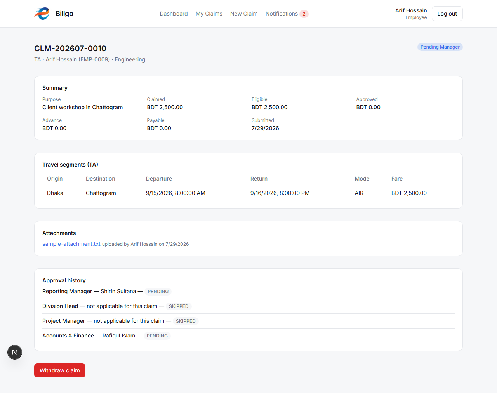

### 2.6 Withdrawing, editing a returned claim, or copying a rejected one

- **Withdraw claim** — available before the *first* approval. Cancels the claim.
- **Discard draft** — deletes an unsubmitted draft.
- If an approver **returns** your claim, you'll see an **Edit & resubmit** button — fix it and
  it goes straight back to the *same* stage that returned it (the original return reason stays
  visible in the approval history).
- If a claim is **rejected**, it becomes read-only, but you can **Copy as new draft** to start
  a fresh claim pre-filled with the same details.

### 2.7 Notifications

The bell-style **Notifications** link shows a badge with your unread count. You get notified
when a claim you submitted is approved/returned/rejected/paid, and when a claim needing your
approval arrives.

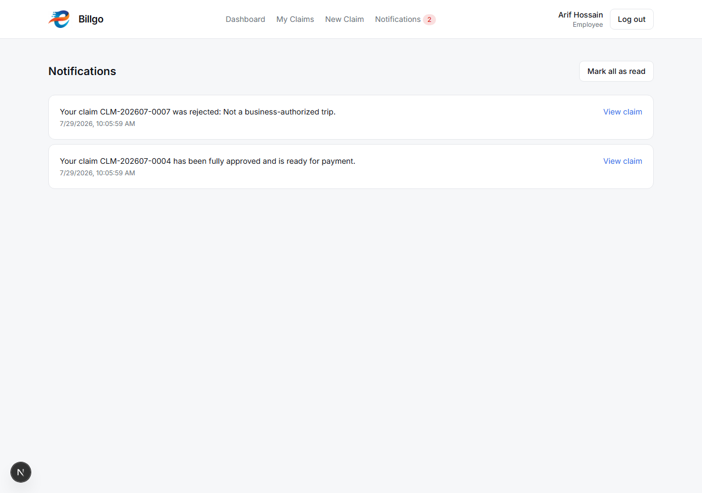

---

## 3. Approvers: reviewing claims

This applies to whoever is currently resolved as a claim's approver at its active stage —
Reporting Manager, Division Head, Department Head, Project Manager, Finance, or Final
Approver. You don't need a special account type for this: if a claim is routed to you, it
shows up in your inbox regardless of your own job title.

### 3.1 Approvals inbox

Click **Approvals** in the nav (only shown when you actually have something pending, with a
count badge). Each row shows which stage it's waiting on you for.

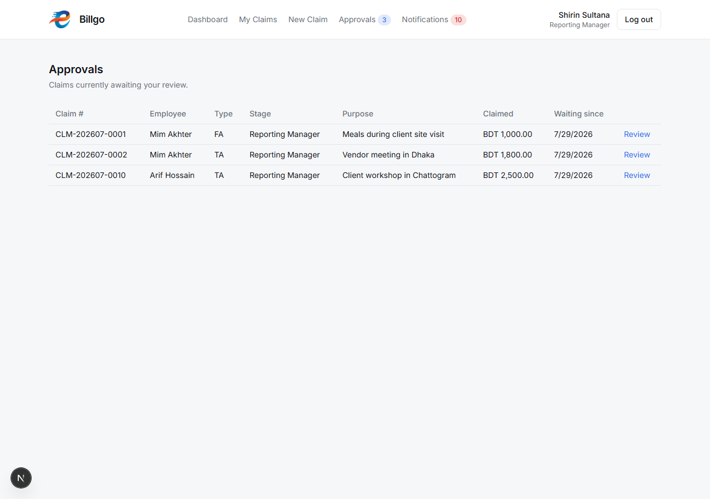

### 3.2 Reviewing a claim

Click **Review** to open the claim. Scroll to **Your approval** at the bottom: add comments
(required if you Return or Reject) and choose:

- **Approve** — moves the claim to the next applicable stage, or finalizes it as `APPROVED`
  if you're the last stage.
- **Return** — sends it back to the claimant to fix and resubmit. Comments are required.
- **Reject** — ends the claim (read-only for the claimant, who may copy it as a new draft).
  Comments are required.

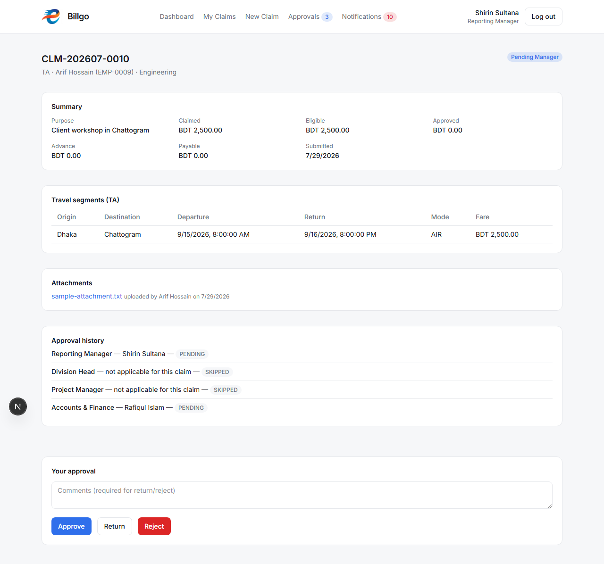

If you're reviewing at the **Finance** stage, you'll also see an optional field to adjust the
approved amount before approving (e.g. if part of a claim is policy-ineligible) — leave it
blank to approve the full eligible amount.

---

## 4. Payment Processor: recording payment

Once a claim reaches **Approved**, it's ready for payment. Find it via **My Claims → All
claims**, filtered to status Approved, and open it. Scroll to **Record payment**: choose a
method, optional reference/batch number, confirm the amount (pre-filled with the payable
amount), and submit.

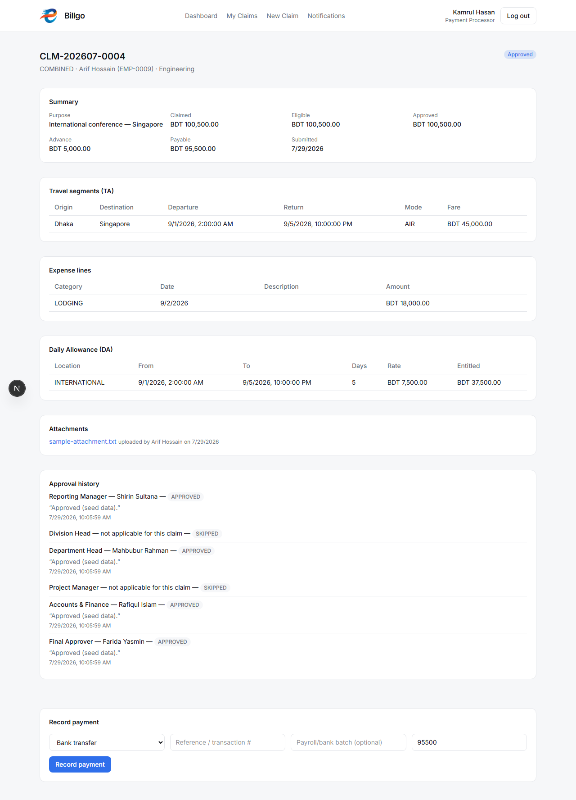

This closes the claim out as **Paid** and notifies the employee.

---

## 5. Administrators: system configuration

Administrators (System Administrator / HR Admin) see an **Admin** menu with these sections.
Every change here is written to the audit log.

### 5.1 Users

Create accounts, assign role/department/division/manager, and activate/deactivate. Grade
(e.g. `G3`, `G4`) drives DA/FA rate lookups, so set it accurately for anyone who'll submit
allowance claims.

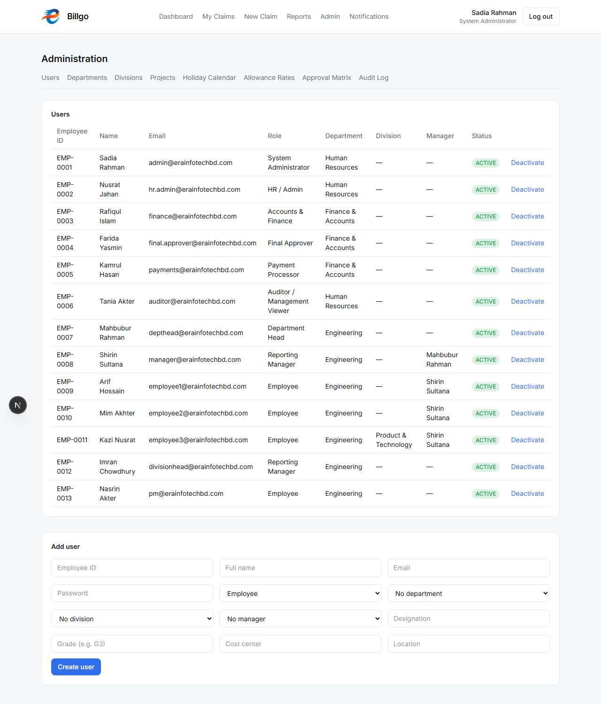

### 5.2 Departments & Divisions

Two independent organizational groupings — a Department and a Division can each have a head
(any user), and the approval matrix can route a stage by either, on top of or instead of the
other.

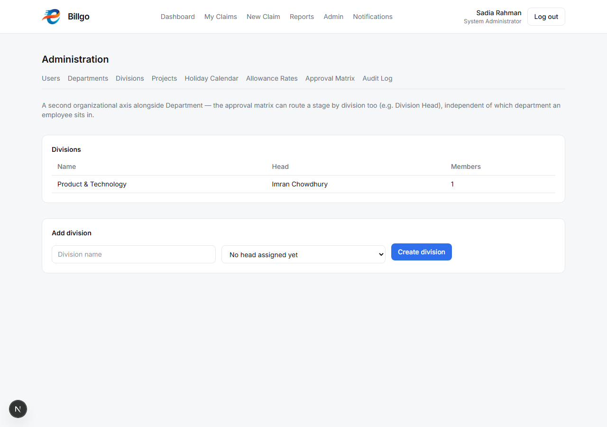

### 5.3 Projects

Each project has exactly one Project Manager. Linking a claim to a project (see §2.3) can
route it to that project's manager as an approval stage — useful for project-charged travel
that needs the project owner's sign-off independent of the reporting line.

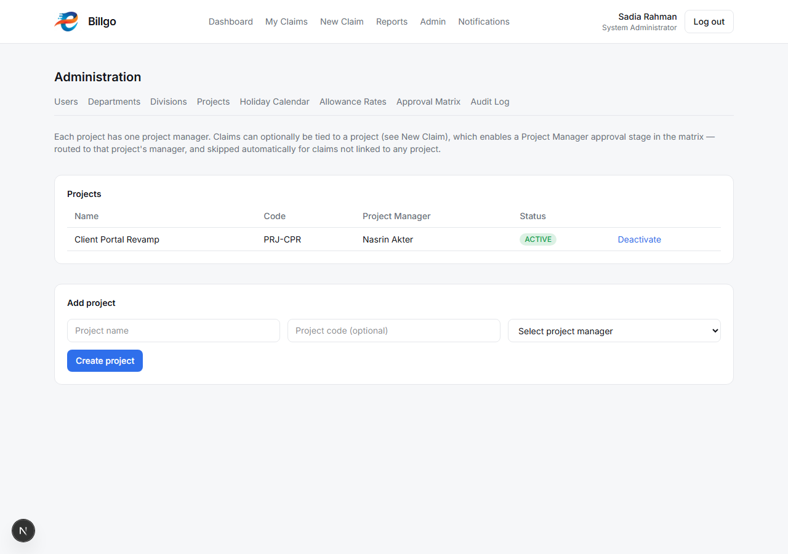

### 5.4 Holiday Calendar

Configure the national/regional/special holidays employees can file Holiday Allowance claims
against. An HA line can only reference a date that's configured here.

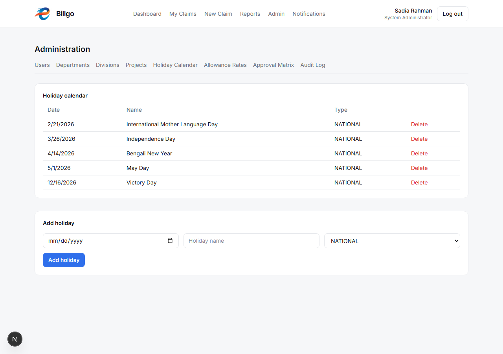

### 5.5 Allowance Rates

Three effective-dated rate tables, one per calculated allowance type — **Daily Allowance
(DA)**, **Food Allowance (FA)**, and **Holiday Allowance (HA)** — each by grade and location
category (Domestic/International) for DA/FA, or grade + multiplier for HA. These drive every
automatic calculation in the system; there is no hardcoded formula.

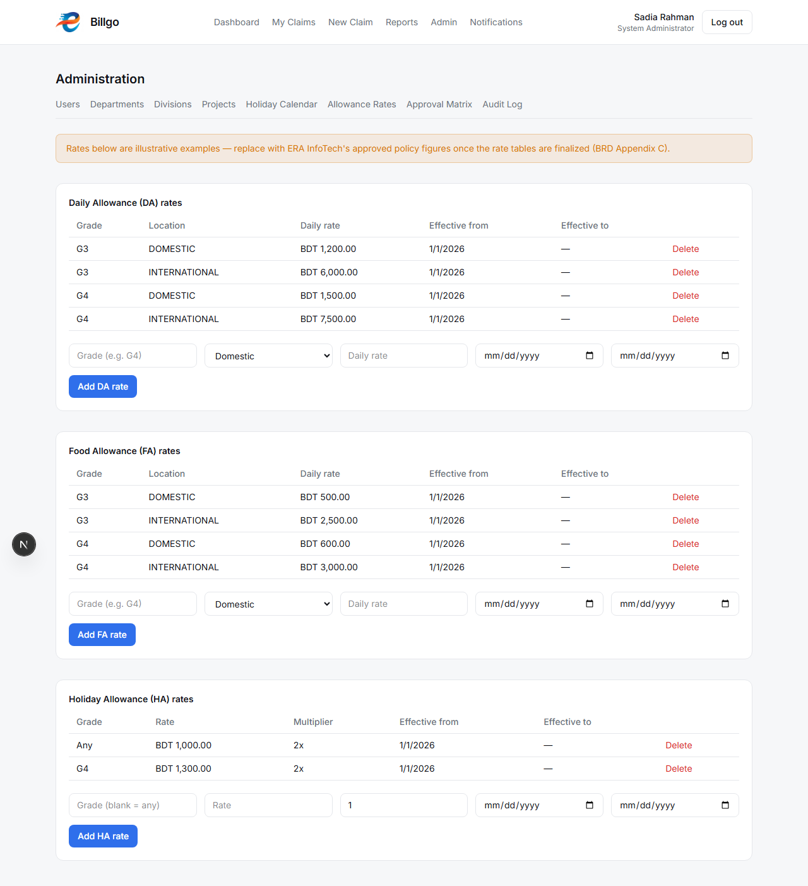

### 5.6 Approval Matrix

The heart of the workflow. Each row is one stage: claim type (or Any), a claimed-amount range
it applies within, an optional department/division scope, a stage order, and the required
approver role.

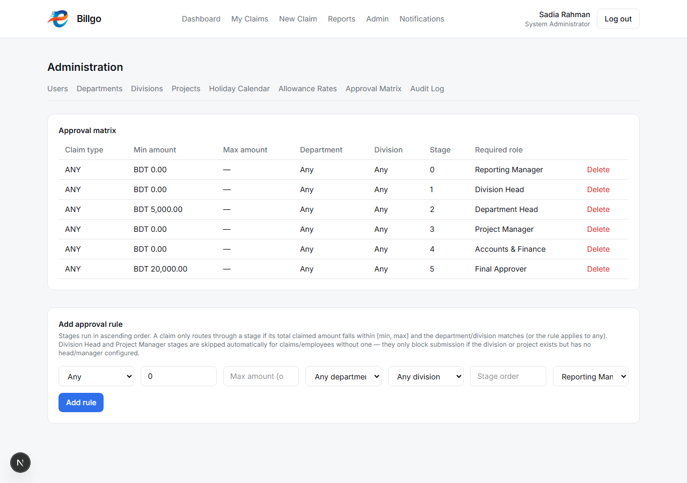

**Reading this table**: stages run in ascending order. A claim only passes through a stage if
its total claimed amount falls in `[min, max]` and the department/division match (or the rule
says "Any"). **Division Head** and **Project Manager** stages don't need to be removed for
employees/claims that don't have one — they're skipped automatically. They only block
submission if the division/project *does* exist but has no head/manager assigned yet (that's
a configuration problem worth fixing here, not a workflow limitation).

### 5.7 Audit Log

A searchable, read-only trail of every material action in the system — claim submissions,
approvals, payments, and every admin configuration change — with who did it and when.

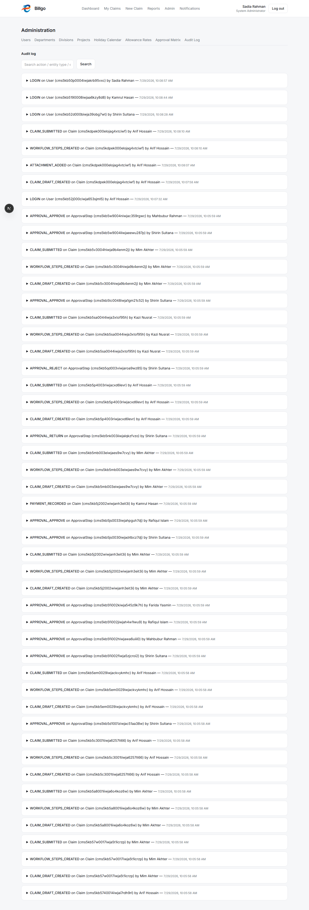

---

## 6. Reports

Finance, Auditor, HR Admin, and System Administrator roles see a **Reports** menu:
**Employee Claim Statement**, **Department-wise Summary**, **Monthly Summary**, **Status
Report**, and **Approval Aging**. Every report can be exported to CSV (opens correctly in
Excel).

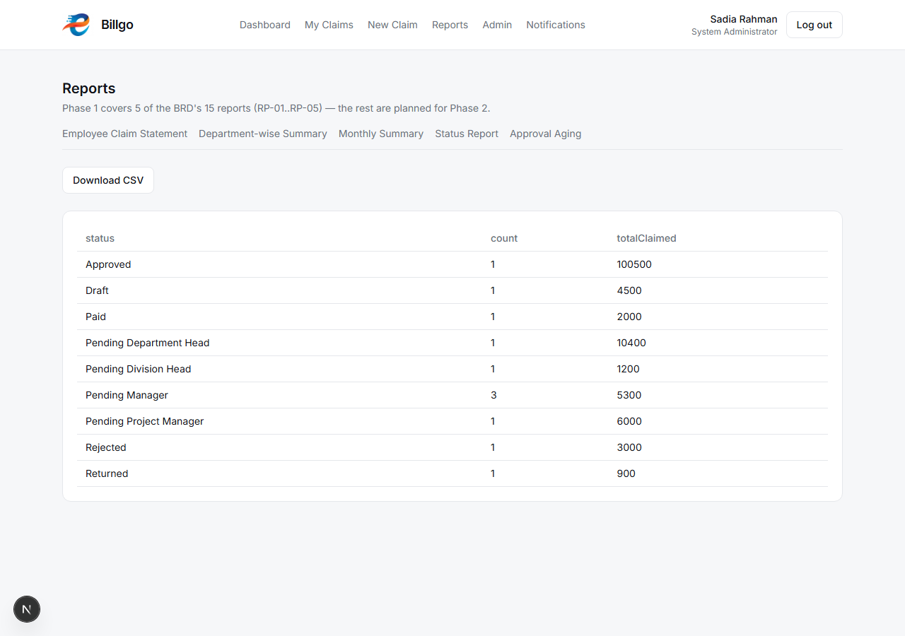

---

## 7. Roles at a glance

| Role | Can do |
|---|---|
| Employee | Create/submit/track/withdraw their own claims |
| Reporting Manager | The above, plus approve claims where they're the claimant's manager |
| Department Head | The above, plus approve claims routed to their department |
| Division Head *(not a fixed job title — anyone can be assigned as one)* | Approve claims from employees in their division |
| Project Manager *(likewise — any user can be assigned)* | Approve claims linked to their project |
| Accounts & Finance | Approve at the Finance stage, adjust approved amounts, view org-wide claims and reports |
| Final Approver | Approve at the final, high-value stage |
| Payment Processor | Record payments on Approved claims, view org-wide claims |
| HR / Admin, System Administrator | Everything above, plus all Admin configuration screens |
| Auditor / Management Viewer | Read-only: org-wide claims, reports, audit log |

A single person can only hold one formal **Role**, but Division Head and Project Manager
assignments are independent of it — a plain Employee can be set as a Project Manager for a
specific project without changing their account role.

---

## 8. Frequently asked questions

**Why is a stage in my approval history marked "SKIPPED"?**
That stage is configured in the approval matrix but didn't apply to your claim — most
commonly Division Head (you're not assigned to a division) or Project Manager (the claim
isn't linked to a project). It's not an error; nothing further is needed from you for that
stage.

**I submitted a claim to the wrong stage / with wrong dates — can I fix it?**
Before the first approval, click **Withdraw claim** and create a corrected one. After the
first approval, contact an Administrator or Finance for an administrative cancellation
(reason required).

**My claim was returned — did I lose my data?**
No. **Edit & resubmit** reopens your original entries for editing; the return reason and your
edit both stay in the approval history.

**Why can't I submit without an attachment?**
Company policy requires at least one supporting document (ticket, invoice, attendance
evidence) before a claim can enter the approval workflow.

**I approved a claim but can't see it anymore — is that a bug?**
No — once acted on, a claim moves off your active queue. You can still find it via **My
Claims → All claims** (if your role has org-wide visibility) to review the outcome.
